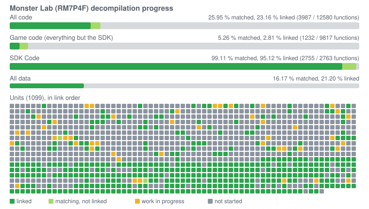
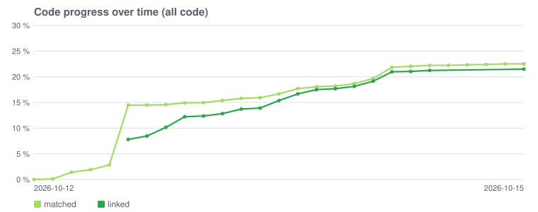

Monster Lab (Wii)
=================

A work-in-progress matching decompilation of Monster Lab for the Wii.

This repository does **not** contain any game assets or assembly whatsoever. An existing
copy of the game is required.

Supported versions:

- `RM7P4F`: Rev 0 (Europe)

Learning guide
==============

[`docs/`](docs/README.md) explains how matching decompilation works, in general and in
this project: concepts, tools, steps taken, a unit from start to finish, problems met
and the daily workflow.

Progress
========





The charts are drawn from the objdiff report by `tools/progress_chart.py`. After a
build, `python tools/progress_chart.py --record` adds the current commit to
`progress/history.csv` and redraws the charts; commit the `progress/` folder with it.
The game figures count every unit outside the SDK, including the ones not split yet.

Dependencies
============

Windows
-------

On Windows, it's **highly recommended** to use native tooling. WSL or msys2 are **not**
required. When running under WSL, [objdiff](#diffing) is unable to get filesystem
notifications for automatic rebuilds.

- Install [Python](https://www.python.org/downloads/) and add it to `%PATH%`.
- Download [ninja](https://github.com/ninja-build/ninja/releases) and add it to `%PATH%`.
  - Quick install via pip: `pip install ninja`

macOS
-----

- Install [ninja](https://github.com/ninja-build/ninja/wiki/Pre-built-Ninja-packages):

  ```sh
  brew install ninja
  ```

[wibo](https://github.com/decompals/wibo), a minimal 32-bit Windows binary wrapper, will
be automatically downloaded and used.

Linux
-----

- Install [ninja](https://github.com/ninja-build/ninja/wiki/Pre-built-Ninja-packages).

[wibo](https://github.com/decompals/wibo) will be automatically downloaded and used.

Building
========

- Clone the repository:

  ```sh
  git clone https://github.com/YggdrasziI/mlab-decomp.git
  ```

- Copy your game's disc image to `orig/RM7P4F`.
  - Supported formats: ISO (GCM), RVZ, WIA, WBFS, CISO, NFS, GCZ, TGC
  - After the initial build, the disc image can be deleted to save space.

- Configure:

  ```sh
  python configure.py
  ```

- Build:

  ```sh
  ninja
  ```

Diffing
=======

Once the initial build succeeds, an `objdiff.json` should exist in the project root.

Download the latest release from [encounter/objdiff](https://github.com/encounter/objdiff).
Under project settings, set `Project directory`. The configuration should be loaded
automatically.

Select an object from the left sidebar to begin diffing. Changes to the project will
rebuild automatically: changes to source files, headers, `configure.py`, `splits.txt` or
`symbols.txt`.


Based on [encounter/dtk-template](https://github.com/encounter/dtk-template).
